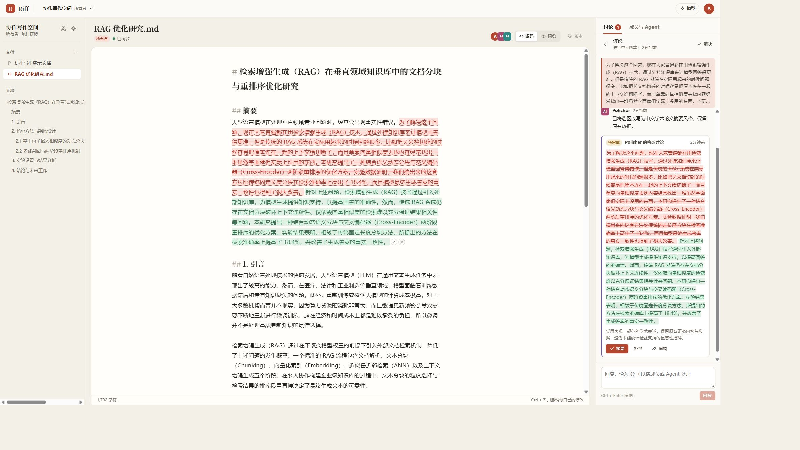
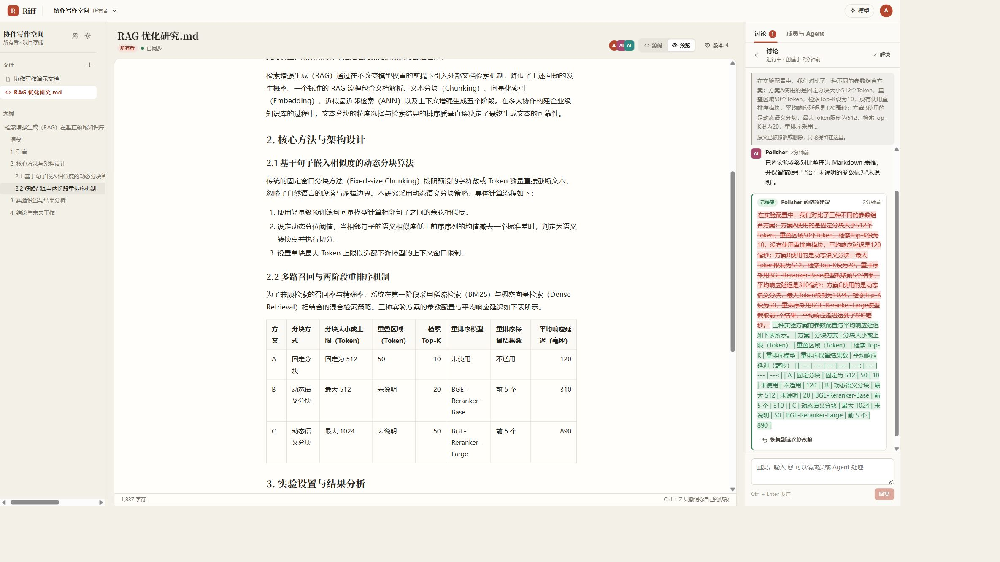
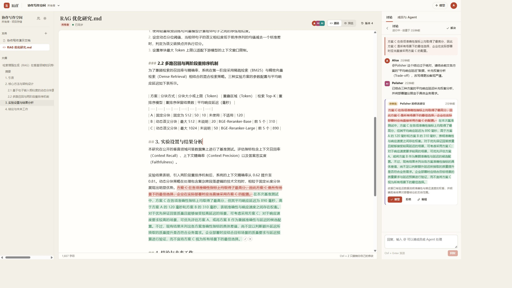

# Riff

**与伙伴和 AI 一起，把每一稿写得更好。**

Riff 是一个让人和 AI Agent 在同一份文档里共同写作、讨论和审阅的工作台。选中一段文字，留下意见，或 `@` 一位 Agent 帮忙修改；对照原文审阅建议，再决定哪些改动进入正文。

从一句话的润色，到一整篇文档的审阅，讨论和修改都留在文字旁边。



*将口语化摘要改为学术表达，保留原有数据，再由你审批。点击图片可查看高清原图。*

## 从一段文字开始

1. **选中，提出想法。** 针对一句话发起评论，让伙伴或 Agent 知道你在讨论哪里。
2. **讨论，形成建议。** 在评论里 `@Agent`，请它调整表达、检查内容，或协助统一术语。
3. **对照，决定修改。** 在正文中查看修改前后的差异，接受合适的建议，拒绝不需要的改动。
4. **继续，一起完善。** 伙伴可以接着回复、编辑和审阅，共同维护同一份文档。

### 把密集参数整理成表格

选中实验参数段落，请 Agent 转成 Markdown 表格。接受建议后，直接在预览中查看三组方案，比较分块方式、检索参数与响应延迟。



### 让修改考虑前文

选中“方案 C 是所有场景下的最佳选择”，请 Agent 结合前文分析。它引用了三组延迟数据，补充准确性与响应速度的权衡，并指出现有证据不足以支持绝对结论。



*使用演示论文，展示真实的 AI 修改与人工审批流程。*

## 让协作围绕文档展开

### 人和 Agent，都在团队里

邀请伙伴加入项目，按分工设置查看、评论、提议修改或编辑的权限。Agent 也作为成员参与讨论，你可以为它选择模型，再把具体任务交给它。

### 意见有位置，修改有对照

评论关联到选中的文字，建议直接显示在正文里。默认由有审批权限的成员接受或拒绝；原文变化导致建议失效时，会标记为过期，Agent 的建议可以重新生成。

### 小到一句，大到整篇

既可以围绕选区讨论，也可以对整篇文档发起任务。一次任务产生多条建议时，可以逐条审阅，也可以批量处理剩余建议。

### 和伙伴一起写

多人可以同时编辑，看到彼此的光标和修改。Markdown 文档支持预览，也可以直接在预览中的文字上选区评论。

### 接着使用你的本地文件

把已有的 `.txt`、`.md` 文件夹连接到项目，在 Riff 中讨论和修改，并将编辑结果写回本地。文件同步状态可以在项目中查看；外部文件发生变化后，点击「同步」检查更新。

## 试用 Riff

Riff 目前是一个需要在本地启动的产品原型。准备好 Node.js 20 或以上版本与 Corepack，在项目目录安装依赖：

```powershell
corepack pnpm install
```

在两个终端中分别启动服务：

```powershell
# 终端 1
corepack pnpm --filter @collab/server dev
```

```powershell
# 终端 2
corepack pnpm --filter @collab/web dev
```

打开 [Riff 工作台](http://127.0.0.1:5173)，注册账户后创建项目。想直接体验预置文档，可以在注册时使用 `alice` 作为账号 handle，认领演示账户。

### 第一次与 Agent 协作

默认的 Polisher 是一个无需模型密钥的演示 Agent，仅按固定规则响应，不能进行自由润色。选中文档中真实存在的一段文字，发表评论：

```text
@Polisher 把「原文」改成「新文」
```

把示例中的「原文」换成选中的文字，再填写你想替换成的内容。建议出现后，点击接受，就能看到正文更新。

要让 Agent 理解自然语言任务，由项目所有者打开顶部「模型」入口，连接模型服务或本机已登录的 Codex CLI、Claude Code，再到「成员与 Agent」中为 Agent 选择提供商和模型。API 密钥仅保留在当前服务进程中，重启后需要重新连接。

## 了解更多

- [演示指南](docs/demo.md)：体验邀请伙伴、选区评论、Agent 建议和批量审阅。
- [本地文件指南](docs/local-project.md)：了解文件夹连接、写回方式与冲突处理限制。浏览器文件夹写回取决于浏览器支持；持续同步也可以使用服务端目录绑定。
- [产品设计](PRODUCT.md)：了解 Riff 面向的用户和协作原则。
- [需求与架构](docs/SPEC.md) · [接口文档](docs/api.md)：供想了解实现或参与开发的人阅读。

<details>
<summary>开发与验证</summary>

默认服务端地址为 `http://127.0.0.1:8787`，前端为 `http://127.0.0.1:5173`。修改服务端端口时，同时设置 `PORT` 与前端代理使用的 `COLLAB_SERVER_PORT`。本地数据默认保存在 `apps/server/collab.db`，可通过 `COLLAB_DB_PATH` 更改位置。

```powershell
# 类型检查、lint 与测试
corepack pnpm check

# 构建前端
corepack pnpm --filter @collab/web build

# 离线上下文与并发评测
corepack pnpm eval:contexts eval/taskset.json --out eval/context-results.csv
corepack pnpm eval:concurrency --clients 4 --steps 200 --seed 42 --out eval/concurrency-results.json
```

上下文评测使用确定性的模拟输出，用于检查上下文策略与输出校验，不代表真实模型的写作质量。并发评测使用固定随机种子模拟客户端操作。

</details>
